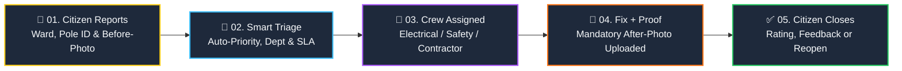

<div align="center">

<!-- Animated Typing SVG Banner -->
<a href="https://vercel.app">
  
</a>

<p align="center">
  <strong>A civic streetlight fault reporting & grievance management platform with guarded workflows, photo proof verification, and built-in CIA security.</strong>
</p>

<!-- Live Status & Tech Stack Badges -->
<p align="center">
  <a href="https://vercel.app">
    
  </a>
  
  
  
  
</p>

<!-- Animated Glowing Pulse Divider -->


</div>

## ✨ Overview

**LuminaTrack (`PRJ-118`)** bridges the gap between citizens and municipal maintenance crews. Citizens can report dark or malfunctioning streetlights in **under 60 seconds without creating an account**, attach photo evidence, and receive an instant tracking ID with an SLA countdown. Meanwhile, the municipal Control Room triages tickets by ward and department through a **state-guarded workflow** that prevents unauthorized status jumps.

<div align="center">

### 🌐 Experience LuminaTrack Live
[](https://vercel.app)

*No login required to file or track a fault • Use Control Room demo access on `/dashboard` to test guarded triage*

</div>

---

## 🎬 2-Minute Live Demo Walkthrough

Test the full end-to-end grievance lifecycle directly on the [live deployment](https://vercel.app):

1. **Report a Fault (`/report`)** — Select a Ward & Zone, enter a Pole ID, describe the fault, upload/attach before-photo proof, and submit to generate an instant **Ticket ID** and **SLA deadline**.
2. **Verify PII Masking (`/`)** — Return to the home page to see your ticket appear on the **Live Public Feed** with personal contact details automatically redacted.
3. **Triage in Control Room (`/dashboard`)** — Sign in using the built-in demo credentials to verify priority, assign a crew (Electrical, Maintenance, Safety, or Contractor), upload after-photo proof, and advance the status through guarded transitions.
4. **Track & Close (`/track`)** — Enter your Ticket ID to inspect the checksum-verified audit timeline, view before/after photo proof, and submit a closure rating (or reopen if the fault persists).
5. **Inspect Analytics & Export (`/analytics`)** — Review ward-level SLA metrics and download a **1-click JSON backup or CSV report**.

---

## 🔄 5-Step Guarded Grievance Workflow

LuminaTrack enforces strict state transitions from initial citizen report to verified closure:



---

## 🚀 Key Features

| Module | Route | Capabilities |
| :--- | :--- | :--- |
| **Landing & Live Feed** | `/` | Real-time KPI counters (tracked tickets, resolution rate, avg fix time, SLA compliance) + PII-masked live public feed. |
| **60-Sec Fault Report** | `/report` | No-login submission with ward/zone tagging (12 wards, 4 zones), pole ID entry, issue categorization, and mandatory photo proof. |
| **Ticket Tracker** | `/track` | Public lookup by Ticket ID showing live SLA deadline, guarded audit timeline, before/after photos, and citizen closure/reopen controls. |
| **Control Room** | `/dashboard` | Role-gated operator workspace for smart triage, crew assignment across 5 departments, guarded status transitions, and proof uploads. |
| **Public Analytics** | `/analytics` | Visual breakdown of ward performance, SLA adherence, department workload, and 1-click **JSON Backup & CSV Export**. |
| **Docs & Viva Guide** | `/docs` | Built-in architectural documentation, security breakdown, and viva Q&A reference. |

---

## 🛡️ CIA Triad Security Architecture

Security in **LuminaTrack** is engineered into the application state and workflow logic:

* **🔒 Confidentiality**
  * Role-gated access control for the Control Room (`/dashboard`).
  * Automatic **PII masking** (phone numbers and emails redacted) on all public feeds and ticket lookups.
  * Zero hardcoded production secrets in source code.
* **✅ Integrity**
  * **Guarded State Machine (`src/lib/lumina.ts`)**: Blocks illegal workflow jumps (e.g., jumping directly from `Submitted` to `Resolved` without crew assignment and after-photo proof).
  * Immutable audit timeline entries and per-ticket integrity checksums.
* **⚡ Availability**
  * **100% Offline-First Resilience (`src/lib/store.tsx`)**: Powered by client-side `localStorage` persistence so reporting and triage work seamlessly even without an active database connection.
  * Instant **JSON snapshot backup** and **CSV export** for zero data lock-in, paired with Drizzle ORM (`src/db/`) for PostgreSQL/SQLite scaling.

---

## 🗂️ Project Structure

```text
streetlight-fault-reporting-system/
├── drizzle.config.json          # Drizzle Kit database configuration
├── next.config.ts               # Next.js configuration
├── package.json                 # Project dependencies & scripts
└── src/
    ├── app/
    │   ├── page.tsx             # Landing page, live KPIs & PII-masked feed
    │   ├── layout.tsx           # Root layout & metadata
    │   ├── globals.css          # Custom animations, transitions & theme tokens
    │   ├── report/page.tsx      # 60-second citizen fault submission form
    │   ├── track/page.tsx       # Public ticket tracking & citizen closure
    │   ├── dashboard/page.tsx   # Role-gated Control Room & triage workflow
    │   ├── analytics/page.tsx   # Ward/SLA analytics & CSV/JSON export
    │   ├── docs/page.tsx        # System docs & viva Q&A
    │   └── api/health/route.ts  # Health-check endpoint
    ├── components/
    │   ├── chrome.tsx           # Navigation shell, headers & layout chrome
    │   ├── charts.tsx           # Interactive analytics & SLA visualizations
    │   └── ui.tsx               # Reusable animated UI primitives
    ├── db/
    │   ├── index.ts             # Database client initialization
    │   └── schema.ts            # Drizzle ORM schema definitions
    └── lib/
        ├── lumina.ts            # Core domain logic, SLA rules, checksums & state guards
        └── store.tsx            # Offline-first React context & localStorage sync
```

---

## 🛠️ Local Setup & Installation

1. **Clone the repository**
   ```bash
   git clone https://github.com<your-username>/streetlight-fault-reporting-system.git
   cd streetlight-fault-reporting-system
   ```

2. **Install dependencies**
   ```bash
   npm install
   ```

3. **Run the development server**
   ```bash
   npm run dev
   ```

4. **Open in your browser**
   Navigate to [http://localhost:3000](http://localhost:3000) to explore the citizen portal and Control Room.

---

## 🎓 Project Credits

* **Project ID:** `PRJ-118` — Public Service Grievance Systems
* **Developer:** Sudharshan Y PDKV (`Reg: 411623149042`)
* **Department:** Department of Cyber Security (Individual Project)

<div align="center">

<!-- Animated Waving Footer -->


</div>
