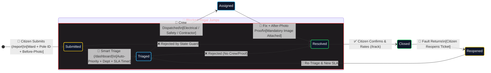
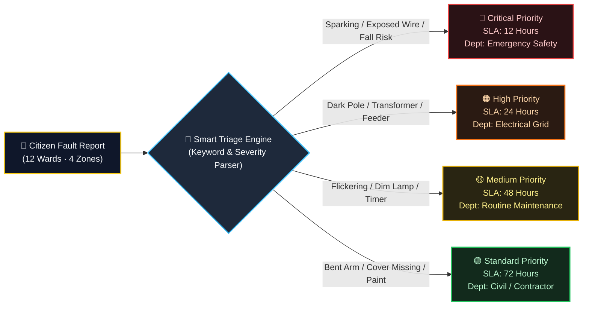
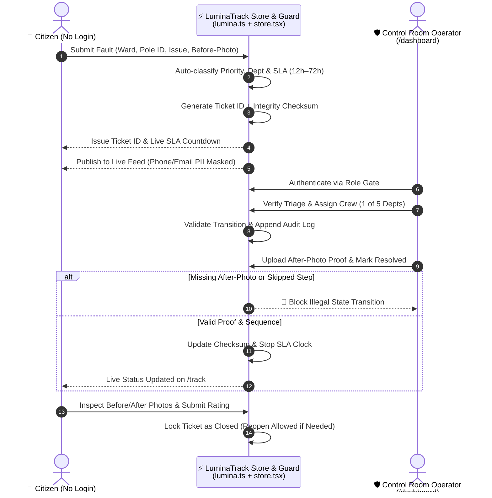

<div align="center">

<!-- Animated Waving & Glowing Header Banner -->
<a href="https://vercel.app">
  
</a>

<!-- Animated Multi-Line Typing Banner -->
<a href="https://vercel.app">
  
</a>

<br/>

<!-- Prominent Live Demo Launch Button -->
<a href="https://vercel.app">
  
</a>

<br/><br/>

<!-- Tech Stack Badges -->
<p align="center">
  
  
  
  
  
</p>

<!-- Animated Glowing Pulse Divider -->


</div>

## ✨ Overview

**LuminaTrack (`PRJ-118`)** is a civic streetlight fault reporting and municipal grievance management platform built for speed, transparency, and verifiable resolution. Citizens report dark or malfunctioning streetlights in **under 60 seconds with zero login required**, attach before-photo proof, and receive an instant tracking ID with an SLA countdown—while the Control Room triages tickets across **12 wards, 4 zones, and 5 departments** through a **state-guarded workflow**.

🌐 **Live Deployment:** [https://vercel.app](https://vercel.app)

---

## 🎬 Live Demo Walkthrough (2-Minute Evaluation Flow)

Test the complete end-to-end grievance lifecycle directly on the [live site](https://vercel.app):

1. **Report a Fault ([`/report`](https://vercel.appreport))** — Choose a Ward & Zone, enter a Pole ID, select an issue category, attach before-photo evidence, and submit to generate an instant **Ticket ID** and **SLA deadline**.
2. **Verify PII Masking ([`/`](https://vercel.app))** — Return to the home dashboard to watch live KPI counters update and verify that citizen phone/email details are automatically redacted on the public feed.
3. **Control Room Triage ([`/dashboard`](https://vercel.appdashboard))** — Sign in with the built-in demo credentials, verify priority, assign a maintenance crew, upload after-photo proof, and advance status through guarded transitions.
4. **Track & Close ([`/track`](https://vercel.apptrack))** — Search your Ticket ID to inspect the checksum-verified audit timeline, compare before/after photos, and submit a closure rating (or reopen if the fault returns).
5. **Analytics & Export ([`/analytics`](https://vercel.appanalytics))** — Inspect ward-level SLA compliance charts and download a **1-click JSON backup or CSV export**.

---

## 🔄 Guarded State Machine & Workflow (`src/lib/lumina.ts`)

LuminaTrack enforces strict state transitions and blocks illegal shortcuts (such as jumping directly from `Submitted` to `Resolved` without crew dispatch and after-photo proof):



---

## 🧠 Smart Triage & SLA Priority Decision Matrix

Keywords and fault severity automatically classify incoming reports into SLA windows (12h–72h) and route them to the responsible municipal department:



---

## 🔁 End-to-End Swimlane Sequence



---

## 🏗️ System Architecture & CIA Triad Security Blueprint

```mermaid
flowchart TB
    subgraph Client ["🌐 Next.js App Router Frontend (Vercel Edge)"]
        direction LR
        P1["🏠 /<br/>Live KPIs &<br/>PII-Masked Feed"]
        P2["🚨 /report<br/>60-Sec Fault<br/>Submission"]
        P3["🔍 /track<br/>Audit Timeline &<br/>Citizen Closure"]
        P4["🎛️ /dashboard<br/>Role-Gated<br/>Control Room"]
        P5["📊 /analytics<br/>Ward SLA Charts &<br/>CSV/JSON Export"]
    end

    subgraph Core ["⚙️ Core Engine & CIA Security Layer"]
        direction LR
        C1["🔒 Confidentiality<br/>• Role Gate Auth<br/>• PII Redaction<br/>• Zero Hardcoded Secrets"]
        C2["✅ Integrity<br/>• Guarded Transitions<br/>• Immutable Audit Log<br/>• Per-Ticket Checksum"]
        C3["⚡ Availability<br/>• Offline-First Store<br/>• 1-Click JSON Backup<br/>• CSV Export"]
    end

    subgraph Storage ["💾 Persistence Layer"]
        direction LR
        S1[("🗄️ Browser localStorage\n(Zero-Backend Mode)")]
        S2[("🐘 Drizzle ORM Schema\n(src/db/schema.ts)")]
    end

    Client ==> Core
    Core ==> S1
    Core -.->|"Scale-Ready"| S2

    style Client fill:#0f172a,stroke:#38bdf8,stroke-width:2px,color:#f8fafc
    style Core fill:#0f172a,stroke:#facc15,stroke-width:2px,color:#f8fafc
    style Storage fill:#0f172a,stroke:#22c55e,stroke-width:2px,color:#f8fafc
    style C1 fill:#1e293b,stroke:#38bdf8,color:#f8fafc
    style C2 fill:#1e293b,stroke:#facc15,color:#f8fafc
